# Comparative Benchmark Report: `pl/jsonschema` (`pl/v8` & `pl/js`) vs. `supabase/pg_jsonschema` on `dev02`

## 1. Executive Summary

This report presents the 4-way end-to-end comparative benchmark results on host **`dev02`** running **PostgreSQL 18.6** across:
1. **`pl/jsonschema` on `pl/v8`** — Ajv v8 Draft-07 code-generating compiler running on `plv8` (`3.2.5` / V8 `15.4.80.15` TurboFan JIT).
2. **`pl/jsonschema` on `pl/js`** — Identical `pl/jsonschema` SQL extension running on `pljs` (`1.0.5` / QuickJS bytecode interpreter with custom JS language handler support).
3. **`supabase/pg_jsonschema` Compiled (`json_matches_compiled_schema`)** — `v0.3.4` (`pgrx 0.19.2`, Rust `jsonschema 0.58.0` crate) with `fn_extra` per-query compiled schema caching.
4. **`supabase/pg_jsonschema` Uncompiled (`json_matches_schema`)** — Standard upstream `v0.3.4` validation function (re-compiles the schema per row).

All **251,755** GitHub Archive JSON records (`1,039,410,676` bytes raw NDJSON file; `1,037,725,715` bytes in-table JSON text; `391,805,195` bytes LZ4-compressed) from `2025-01-15-14.json` were loaded into `public.jdata` (`COMPRESSION lz4`) with a B-tree expression index on `data ->> 'type'`, and validated against the **15 event-specific Draft-07 JSON Schemas**.

> [!IMPORTANT] **Headline 4-Way Benchmark Results (`251,755` rows across 15 event types on `dev02`)**
> | Engine / Mode | End-to-End Total (`ms`) | Net Validation Above LZ4 (`ms`) | Net Validation (`µs/row`) | Speedup vs. `pg_jsonschema` Uncompiled (End-to-End / Net) |
> | :--- | ---: | ---: | ---: | ---: |
> | **Baseline Index Scan + LZ4 Decompression (`count(length(data::text))`)** | **`3,428.52 ms`** | `0.00 ms` | `—` | `—` |
> | **1. `pl/jsonschema` on `pl/v8` (V8 TurboFan JIT, Warm Median)** | **`4,870.00 ms`** | **`1,441.48 ms`** | **`5.73 µs/row`** | **`9.14x` / `28.49x` faster** |
> | **2. `supabase/pg_jsonschema` Compiled (`json_matches_compiled_schema`)** | **`5,497.83 ms`** | **`2,069.31 ms`** | **`8.22 µs/row`** | **`8.09x` / `19.84x` faster** |
> | **3. `pl/jsonschema` on `pl/js` (QuickJS Bytecode, Warm Median)** | **`9,237.10 ms`** | **`5,808.58 ms`** | **`23.07 µs/row`** | **`4.82x` / `7.07x` faster** |
> | **4. `supabase/pg_jsonschema` Uncompiled (`json_matches_schema`)** | **`44,493.29 ms`** | **`41,064.77 ms`** | **`163.11 µs/row`** | `1.00x` / `1.00x` (baseline) |
>
> - **`pl/jsonschema` on `pl/v8` is the fastest engine overall**: **`1.13x` faster end-to-end** and **`1.44x` faster in net validation** than `supabase/pg_jsonschema` Compiled across all 251,755 rows, and **`1.61x–1.64x` faster end-to-end (`3.15x–3.45x` faster in net validation)** on complex `10 KB–55 KB` schemas (`PullRequestEvent`, `PullRequestReviewEvent`, `PullRequestReviewCommentEvent`, `ForkEvent`).
> - **`pl/jsonschema` on `pl/js` (QuickJS) outperforms standard `pg_jsonschema` (`json_matches_schema`) by `4.82x` end-to-end (`7.07x` net validation)**: Even with a lightweight, JIT-less bytecode interpreter (`QuickJS`), Ajv's pre-compiled schema validators cached in the persistent `pl/js` context beat `json_matches_schema` on all 15 event types (`2.84x–8.71x` end-to-end; `5.16x–11.04x` net validation).
> - **`pl/v8` vs. `pl/js` Engine Comparison**: V8's TurboFan JIT and SIMD-accelerated `JSON.parse` make `pl/jsonschema` on `pl/v8` **`1.90x` faster end-to-end** (`4.03x` faster in net validation) than `pl/jsonschema` on `pl/js` overall—ranging from `1.89x` net speedup on small flat payloads (`WatchEvent`) to `7.09x–7.94x` net speedup on `20 KB` `PullRequest*` payloads.
> - **100% Validation Parity Across All 4 Engines**: `pl/jsonschema` (`pl/v8`), `pl/jsonschema` (`pl/js`), `pg_jsonschema` Compiled, and `pg_jsonschema` Uncompiled returned identical counts on every single one of the 15 event types (`251,697` rows `true`, `58` rows `false`).

---

## 2. Test Environment & Dataset Configuration (`dev02`)

### 2.1 System & Extension Stack
| Component | Specification on `dev02` |
| :--- | :--- |
| **Host** | `dev02` (Linux x86_64) |
| **PostgreSQL Server** | PostgreSQL `18.6` (`REL_18_STABLE`, commit `30baaac`) installed at `/home/hannuk/pg18`, port `55432`, socket `/tmp`, database `jsondata` |
| **TOAST Compression** | `lz4` (`ALTER TABLE ONLY public.jdata ALTER COLUMN data SET COMPRESSION lz4;` backed by `liblz4.so.1`) |
| **V8 / `plv8` Runtime** | `plv8` `3.2.5` with embedded V8 `15.4.80.15` (`shared_preload_libraries = 'plv8-3.2.5'`, single-Isolate multi-context architecture) |
| **QuickJS / `pljs` Runtime** | `pljs` `1.0.5` with vendored QuickJS + custom JS language handler support (`pljs.memory_limit = 512MB`, `js_stack_size = 2MB`) |
| **`pl/jsonschema`** | `1.0` ([`pl_jsonschema.sql.in`](../pl_jsonschema.sql.in), dual-engine `pl_jsonschema.engine = 'plv8' | 'pljs'`, bundled Ajv v8 Draft-07 compiler with `{ allErrors: false, strict: false, validateFormats: false }`) |
| **`supabase/pg_jsonschema`** | `v0.3.4` (`master`, compiled with `rustc 1.99.0`, `cargo-pgrx 0.19.2`, `jsonschema 0.58.0`, `--features pg18 --release`) |
| **Execution Parallelism** | `SET max_parallel_workers_per_gather = 0;` (single-backend apples-to-apples per-row comparison) |

### 2.2 Table DDL, Data Load & Storage Metrics
```sql
CREATE TABLE public.jdata (
    id integer NOT NULL,
    data json
);
ALTER TABLE ONLY public.jdata ALTER COLUMN data SET COMPRESSION lz4;
CREATE INDEX jdata_type_idx ON public.jdata USING btree ((data ->> 'type'));
VACUUM ANALYZE public.jdata;
```

- **Data Load (`2025-01-15-14.json` $\rightarrow$ `public.jdata`)**: `251,755` rows loaded in **`4.15 s`** on `dev02`
- **Index Build (`jdata_type_idx`) + `VACUUM ANALYZE`**: **`1.50 s`** on `dev02`
- **Total Uncompressed JSON Payload (`sum(length(data::text))`)**: `1,037,725,715` bytes (`989.65 MB`)
- **Total LZ4-Compressed Column Size (`sum(pg_column_size(data))`)**: `391,805,195` bytes (`373.65 MB`, **`2.65x` overall compression ratio**; up to **`4.84x`** on `PullRequestEvent`)

---

## 3. 4-Way Comparative Benchmark Results Across All 15 Event Types (`dev02`)

The complete raw JSON benchmark output from `dev02` is stored in [`benchmarks/dev02_results.json`](../benchmarks/dev02_results.json).

### 3.1 End-to-End Query Execution Time (ms) — All 15 Event Types
Each query executes `SELECT count(<check>) FROM public.jdata WHERE data ->> 'type' = '<EventType>';` over 5 warm iterations (median reported below) plus 1 cold first-call iteration:

| Event Type | Rows | Avg JSON (B) | Schema (B) | Baseline LZ4 Scan (ms) | `pl/v8` Cold (ms) | **`pl/v8` Warm Med (ms)** | `pl/js` Cold (ms) | **`pl/js` Warm Med (ms)** | **`pg_jsonschema` Compiled Med (ms)** | **`pg_jsonschema` Uncompiled (ms)** | `pl/v8` vs. Compiled | `pl/v8` vs. `pl/js` | `pl/js` vs. Uncompiled |
| :--- | ---: | ---: | ---: | ---: | ---: | ---: | ---: | ---: | ---: | ---: | ---: | ---: | ---: |
| **`CommitCommentEvent`** | `125` | `3,858` | `5,627` | `0.77` | `38.45` | **`1.29`** | `53.41` | **`2.69`** | `1.33` | `12.44` | **`1.03x`** | `2.09x` | **`4.62x`** |
| **`CreateEvent`** | `30,506` | `608` | `2,156` | `49.31` | `154.36` | **`151.01`** | `268.45` | **`248.35`** | `84.37` | `1,228.85` | `0.56x` | `1.64x` | **`4.95x`** |
| **`DeleteEvent`** | `6,854` | `604` | `1,936` | `8.94` | `33.91` | **`30.04`** | `64.17` | **`55.84`** | `17.38` | `251.77` | `0.58x` | `1.86x` | **`4.51x`** |
| **`ForkEvent`** | `2,457` | `6,000` | `9,737` | `23.02` | `45.33` | **`29.41`** | `118.01` | **`92.44`** | `45.05` | `430.65` | **`1.53x`** | `3.14x` | **`4.66x`** |
| **`GollumEvent`** | `321` | `760` | `2,441` | `0.45` | `6.08` | **`1.39`** | `11.41` | **`2.87`** | `0.98` | `14.05` | `0.71x` | `2.06x` | **`4.90x`** |
| **`IssueCommentEvent`** | `12,480` | `9,378` | `27,422` | `218.99` | `407.50` | **`346.81`** | `859.73` | **`794.34`** | `390.84` | `5,243.19` | **`1.13x`** | `2.29x` | **`6.60x`** |
| **`IssuesEvent`** | `5,658` | `4,320` | `18,935` | `42.93` | `96.35` | **`74.71`** | `241.79` | **`185.20`** | `83.62` | `1,613.41` | **`1.12x`** | `2.48x` | **`8.71x`** |
| **`MemberEvent`** | `925` | `1,507` | `3,322` | `2.07` | `9.69` | **`4.57`** | `23.45` | **`12.07`** | `4.16` | `55.21` | `0.91x` | `2.64x` | **`4.57x`** |
| **`PublicEvent`** | `905` | `459` | `1,752` | `1.04` | `6.34` | **`3.17`** | `12.43` | **`5.59`** | `1.69` | `28.83` | `0.53x` | `1.76x` | **`5.16x`** |
| **`PullRequestEvent`** | `18,363` | `19,678` | `52,442` | `599.77` | `1,037.91` | **`839.93`** | `2,402.29` | **`2,302.12`** | `1,355.75` | `14,086.02` | **`1.61x`** | `2.74x` | **`6.12x`** |
| **`PullRequestReviewCommentEvent`** | `5,322` | `23,345` | `55,362` | `193.93` | `378.75` | **`271.53`** | `905.33` | **`775.43`** | `446.23` | `4,375.53` | **`1.64x`** | `2.86x` | **`5.64x`** |
| **`PullRequestReviewEvent`** | `8,516` | `21,435` | `52,823` | `304.71` | `561.79` | **`410.18`** | `1,280.91` | **`1,142.26`** | `667.01` | `6,634.43` | **`1.63x`** | `2.78x` | **`5.81x`** |
| **`PushEvent`** | `147,906` | `1,195` | `2,930` | `1,959.33` | `2,656.79` | **`2,646.88`** | `3,519.35` | **`3,508.01`** | `2,356.76` | `9,955.79` | `0.89x` | `1.33x` | **`2.84x`** |
| **`ReleaseEvent`** | `1,355` | `4,609` | `10,724` | `10.44` | `49.45` | **`15.82`** | `69.43` | **`39.69`** | `18.60` | `225.13` | **`1.18x`** | `2.51x` | **`5.67x`** |
| **`WatchEvent`** | `10,062` | `508` | `1,811` | `12.82` | `49.04` | **`43.26`** | `76.11` | **`70.20`** | `24.06` | `337.99` | `0.56x` | `1.62x` | **`4.81x`** |
| **Total (`251,755` rows)** | **`251,755`** | **`4,122`** | **`249,420`** | **`3,428.52`** | **`5,531.74`** | **`4,870.00`** | **`9,906.27`** | **`9,237.10`** | **`5,497.83`** | **`44,493.29`** | **`1.13x`** | **`1.90x`** | **`4.82x`** |

```mermaid
xychart-beta
    title "End-to-End Validation Time on Heavy Event Types (ms, Lower is Better)"
    x-axis ["PullRequestEvent (18.4k)", "PushEvent (147.9k)", "PullRequestReviewEvent (8.5k)", "IssueCommentEvent (12.5k)", "PRReviewCommentEvent (5.3k)"]
    y-axis "Execution Time (ms)" 0 --> 3600
    bar [839.93, 2646.88, 410.18, 346.81, 271.53]
    bar [1355.75, 2356.76, 667.01, 390.84, 446.23]
    bar [2302.12, 3508.01, 1142.26, 794.34, 775.43]
```


*(Bar 1: `pl/jsonschema` on `pl/v8`; Bar 2: `supabase/pg_jsonschema` Compiled; Bar 3: `pl/jsonschema` on `pl/js`)*

---

### 3.2 Net Schema Validation Overhead (Subtracting Baseline Index Scan + LZ4 Decompression)

Because all 4 modes read the exact same B-tree index (`jdata_type_idx`) and decompress the same LZ4 TOAST slices (`3,428.52 ms` total across all 15 queries), subtracting `baseline_lz4_med_ms` isolates the **net JSON parsing + schema validation CPU cost** of each engine (ordered below from largest to smallest schema):

| Event Type | Rows | Schema (B) | **`pl/jsonschema` (`pl/v8`) Net** | **`pl/jsonschema` (`pl/js`) Net** | **`pg_jsonschema` Compiled Net** | **`pg_jsonschema` Uncompiled Net** | **`pl/v8` vs. Compiled (Net)** | **`pl/v8` vs. `pl/js` (Net)** | **`pl/js` vs. Uncompiled (Net)** |
| :--- | ---: | ---: | ---: | ---: | ---: | ---: | ---: | ---: | ---: |
| **`PullRequestReviewCommentEvent`** | `5,322` | `55,362` | **`77.60 ms`** (`14.58 µs`) | **`581.50 ms`** (`109.26 µs`) | `252.30 ms` (`47.41 µs`) | `4,181.60 ms` (`785.72 µs`) | **`3.25x`** | `7.49x` | **`7.19x`** |
| **`PullRequestReviewEvent`** | `8,516` | `52,823` | **`105.47 ms`** (`12.38 µs`) | **`837.55 ms`** (`98.35 µs`) | `362.30 ms` (`42.54 µs`) | `6,329.72 ms` (`743.27 µs`) | **`3.44x`** | `7.94x` | **`7.56x`** |
| **`PullRequestEvent`** | `18,363` | `52,442` | **`240.16 ms`** (`13.08 µs`) | **`1,702.35 ms`** (`92.71 µs`) | `755.98 ms` (`41.17 µs`) | `13,486.25 ms` (`734.43 µs`) | **`3.15x`** | `7.09x` | **`7.92x`** |
| **`IssueCommentEvent`** | `12,480` | `27,422` | **`127.82 ms`** (`10.24 µs`) | **`575.35 ms`** (`46.10 µs`) | `171.85 ms` (`13.77 µs`) | `5,024.20 ms` (`402.58 µs`) | **`1.34x`** | `4.50x` | **`8.73x`** |
| **`IssuesEvent`** | `5,658` | `18,935` | **`31.78 ms`** (`5.62 µs`) | **`142.27 ms`** (`25.14 µs`) | `40.69 ms` (`7.19 µs`) | `1,570.48 ms` (`277.57 µs`) | **`1.28x`** | `4.48x` | **`11.04x`** |
| **`ReleaseEvent`** | `1,355` | `10,724` | **`5.38 ms`** (`3.97 µs`) | **`29.25 ms`** (`21.59 µs`) | `8.16 ms` (`6.02 µs`) | `214.69 ms` (`158.44 µs`) | **`1.52x`** | `5.44x` | **`7.34x`** |
| **`ForkEvent`** | `2,457` | `9,737` | **`6.39 ms`** (`2.60 µs`) | **`69.42 ms`** (`28.25 µs`) | `22.03 ms` (`8.97 µs`) | `407.63 ms` (`165.91 µs`) | **`3.45x`** | `10.86x` | **`5.87x`** |
| **`CommitCommentEvent`** | `125` | `5,627` | **`0.52 ms`** (`4.16 µs`) | **`1.92 ms`** (`15.36 µs`) | `0.56 ms` (`4.48 µs`) | `11.67 ms` (`93.36 µs`) | **`1.08x`** | `3.69x` | **`6.08x`** |
| **`MemberEvent`** | `925` | `3,322` | **`2.50 ms`** (`2.70 µs`) | **`10.00 ms`** (`10.81 µs`) | `2.09 ms` (`2.26 µs`) | `53.14 ms` (`57.45 µs`) | `0.84x` | `4.00x` | **`5.31x`** |
| **`PushEvent`** | `147,906` | `2,930` | **`687.55 ms`** (`4.65 µs`) | **`1,548.68 ms`** (`10.47 µs`) | `397.43 ms` (`2.69 µs`) | `7,996.46 ms` (`54.06 µs`) | `0.58x` | `2.25x` | **`5.16x`** |
| **`GollumEvent`** | `321` | `2,441` | **`0.94 ms`** (`2.93 µs`) | **`2.42 ms`** (`7.54 µs`) | `0.53 ms` (`1.65 µs`) | `13.60 ms` (`42.37 µs`) | `0.56x` | `2.57x` | **`5.62x`** |
| **`CreateEvent`** | `30,506` | `2,156` | **`101.70 ms`** (`3.33 µs`) | **`199.04 ms`** (`6.52 µs`) | `35.06 ms` (`1.15 µs`) | `1,179.54 ms` (`38.67 µs`) | `0.34x` | `1.96x` | **`5.93x`** |
| **`DeleteEvent`** | `6,854` | `1,936` | **`21.10 ms`** (`3.08 µs`) | **`46.90 ms`** (`6.84 µs`) | `8.44 ms` (`1.23 µs`) | `242.83 ms` (`35.43 µs`) | `0.40x` | `2.22x` | **`5.18x`** |
| **`WatchEvent`** | `10,062` | `1,811` | **`30.44 ms`** (`3.03 µs`) | **`57.38 ms`** (`5.70 µs`) | `11.24 ms` (`1.12 µs`) | `325.17 ms` (`32.32 µs`) | `0.37x` | `1.89x` | **`5.67x`** |
| **`PublicEvent`** | `905` | `1,752` | **`2.13 ms`** (`2.35 µs`) | **`4.55 ms`** (`5.03 µs`) | `0.65 ms` (`0.72 µs`) | `27.79 ms` (`30.71 µs`) | `0.31x` | `2.14x` | **`6.11x`** |
| **Total (`251,755` rows)** | **`251,755`** | **`249,420`** | **`1,441.48 ms`** (`5.73 µs`) | **`5,808.58 ms`** (`23.07 µs`) | **`2,069.31 ms`** (`8.22 µs`) | **`41,064.77 ms`** (`163.11 µs`) | **`1.44x`** | **`4.03x`** | **`7.07x`** |

---

## 4. Deep-Dive Architectural Analysis

### 4.1 Why `pl/jsonschema` on `pl/v8` Dominates on Complex Schemas (`3.15x–3.45x` Faster Net Validation vs. `pg_jsonschema` Compiled)
- **Ajv v8 Code Generation + V8 TurboFan JIT vs. AST Interpretation**:
  - `pl/jsonschema` compiles each JSON Schema into a specialized JavaScript function containing flat property accesses (`data.payload.pull_request.head.repo...`), inlined `typeof` checks, and short-circuit boolean logic (`allErrors: false`). V8's TurboFan compiler then JIT-compiles that generated JS into native x86_64 machine code with hidden-class inline caches.
  - By contrast, `supabase/pg_jsonschema` (`jsonschema 0.58.0`) compiles the schema into a tree of heap-allocated trait/enum validator nodes (`Validator`) and walks that validator tree dynamically against a `serde_json::Value` DOM tree on every row.
  - When a schema has hundreds of nested properties and union types (`PullRequestEvent` at `52.4 KB`, `PullRequestReviewCommentEvent` at `55.4 KB`, `PullRequestReviewEvent` at `52.8 KB`), V8's JIT-compiled native validator plus V8's SIMD-accelerated `JSON.parse` processes `20 KB` payloads in **`12.4–14.6 µs/row`**, whereas `serde_json` + `jsonschema` AST traversal takes **`41.2–47.4 µs/row`**.

### 4.2 Comparing `pl/jsonschema` on `pl/v8` (V8 JIT) vs. `pl/jsonschema` on `pl/js` (QuickJS Interpreter)
- Both `pl/v8` and `pl/js` run the **exact same `pl/jsonschema` SQL extension** (`pl_jsonschema--1.0.sql`) and the **exact same Ajv-generated JavaScript validator code**.
- On small payloads (`450–1,200 B` events like `WatchEvent`, `CreateEvent`, `PublicEvent`, `DeleteEvent`, `PushEvent`), `pl/js` takes **`5.0–10.5 µs/row`** net validation compared to `pl/v8`'s **`2.4–4.7 µs/row`** (`1.89x–2.25x` difference)—demonstrating that QuickJS's lightweight C-to-JS call boundary and bytecode interpreter are remarkably competitive on small documents while having a tiny memory footprint.
- On large `20 KB` payloads (`PullRequest*`), `pl/v8` (`12.4–14.6 µs/row`) is **`7.09x–7.94x` faster in net validation** than `pl/js` (`92.7–109.3 µs/row`) for two reasons:
  1. **V8 SIMD `JSON.parse` vs. QuickJS `JS_ParseJSON`**: Parsing a `20 KB` JSON document into JS objects per row uses SIMD string scanning and shape transitions in V8, whereas QuickJS's `JS_ParseJSON` is a single-pass scalar C parser that reference-counts and frees every nested property atom and object on return.
  2. **V8 TurboFan JIT vs. QuickJS Bytecode Dispatch**: An Ajv validator for a `55 KB` schema executes ~1,500 property checks per `PullRequest*` row; V8 compiles those checks into inline-cached native machine code, whereas QuickJS dispatches bytecode instructions.
- Crucially, even without a JIT, **`pl/jsonschema` on `pl/js` is `4.82x` faster end-to-end (`7.07x` faster net validation) than standard `supabase/pg_jsonschema` (`json_matches_schema`)** across the dataset (`9.24 s` vs. `44.49 s`).

### 4.3 Session-Persistent Caching (`pl/jsonschema`) vs. Per-Query Caching (`pg_jsonschema` Compiled)
- **`pl/jsonschema` (`pl/v8` & `pl/js`)**: Caches compiled Ajv validators in `pl.validator[key]` inside the persistent V8 / QuickJS context (and in `TopMemoryContext` function caches). Across repeated SQL queries in a connection, schema compilation cost is **zero** (`0 ms`).
- **`supabase/pg_jsonschema` Compiled**: `fn_extra_get_or_compile` caches the compiled `Validator` in `fcinfo->flinfo->fn_extra`, which is allocated in `flinfo->fn_mcxt` (**query-lifespan memory context**). Thus, `json_matches_compiled_schema` must re-parse and re-compile the `jsonschema` datum **once at the beginning of every SQL query**.
- **`supabase/pg_jsonschema` Uncompiled (`json_matches_schema`)**: Re-compiles the JSON Schema **on every single row**, resulting in `44.49 s` total execution time (`9.14x` slower than `pl/jsonschema` on `pl/v8` and `4.82x` slower than `pl/jsonschema` on `pl/js`).

---

## 5. Bugs Identified & Fixed During Benchmark Execution

1. **Draft-07 `"format": "date-time"` and Union-Type Parity in `pl/jsonschema`**:
   - All 15 generated GitHub Archive schemas contain `"format": "date-time"` and union object types (`"type": ["null", "object"], "properties": {...}`).
   - `supabase/pg_jsonschema` (`jsonschema` crate) disables format assertions by default (`should_validate_formats = false`), whereas standalone `new Ajv()` in `pl/jsonschema` defaulted to `strict: true, validateFormats: true` with an empty format registry, rejecting all 15 schemas at `CREATE FUNCTION` time with `unknown format "date-time" ignored in schema`.
   - **Fix**: Updated [`pl_jsonschema.sql.in`](../pl_jsonschema.sql.in) to initialize Ajv via `__pljsonschema_new_ajv()` with `{ allErrors: false, strict: false, validateFormats: false }`.
2. **`postsql/plv8` `v4.0` Validator Compatibility (`plv8.find_function(oid)`)**:
   - In `postsql/plv8` `v4.0` on `dev02`, `find_js_function(Oid fn_oid)` only checks `prolang == plv8`, causing `pl.find_function(String(func_oid))` inside `pljsonschema_call_validator(func_oid)` to fail with `ERROR: Error: javascript function "<oid>" does not exist` when `check_function_bodies = on`.
   - **Fix**: Updated [`pljsonschema_call_validator`](../pl_jsonschema.sql.in) in `pl_jsonschema.sql.in` to fall back to direct Ajv schema compilation inside the validator when `pl.find_function(String(func_oid))` reports that the non-`plv8` language OID is not a direct `plv8` function.
3. **Three Critical `pljs` / QuickJS Fixes Discovered During the 251,755-Row Benchmark**:
   - **Unformatted Stack-Overflow Exception (`deps/quickjs/quickjs.c` `JS_ThrowError2`)**: A guard `if (js_check_stack_overflow(ctx->rt, 0)) return JS_EXCEPTION;` at the entry of `JS_ThrowError2` returned `JS_EXCEPTION` without setting `rt->current_exception`, causing stack overflows to surface as `ERROR: [unsupported type]: [no message]`. Removing that guard restored proper `InternalError: stack overflow` reporting.
   - **QuickJS C-Stack Budget Floor (`src/pljs.c` `_PG_init`)**: `_PG_init` set `js_stack_size = Max(max_stack_depth * 1024 / 2, 256 * 1024)` (`1 MB` when `max_stack_depth = 2MB`), whereas Ajv v8's recursive schema compiler needs `~1.3 MB` of C stack to compile the deeply nested `52–55 KB` `PullRequest*` schemas in QuickJS. Raising the floor to `2048 * 1024` (`2 MB`) enabled all 15 schemas to compile and validate cleanly.
   - **Per-Row Argument `JSValue` Leak in `pljs_call_handler` (`src/pljs.c`) & Per-Row `prosrc` Copy (`src/cache.c`)**:
     - `pljs_call_handler` passed `argv` (populated via `JS_ParseJSON` in `convert_arguments_to_javascript`) to `JS_Call` without freeing `argv[0..argc-1]` afterward, leaking every row's parsed JSON object on QuickJS's heap until `pljs.memory_limit` (`512 MB`) was exhausted after ~250,000 rows. Adding `JS_FreeValue(context.ctx, argv[i])` in `pljs_call_handler` (both normal return and `PG_CATCH`) eliminated the leak completely.
     - `pljs_function_cache_to_context` called `pstrdup(function_entry->prosrc)` on every cached function call, copying the `~450 KB` transpiled Ajv bundle on every single row. Borrowing `function_entry->prosrc` on cache hits cut `CreateEvent` warm execution time on `pl/js` from `345.19 ms` to **`248.35 ms`** (`28%` faster).
