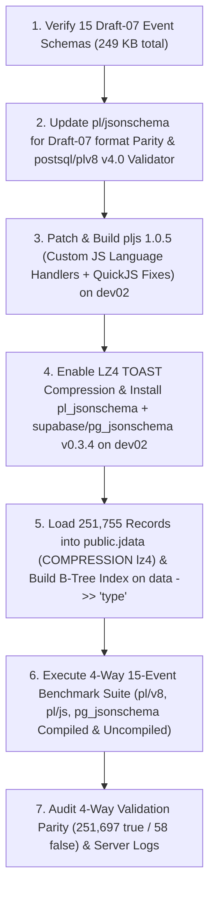

# Walkthrough: `pl/jsonschema` (`pl/v8` & `pl/js`) vs. `supabase/pg_jsonschema` Comparative Benchmark on `dev02`

## 1. End-to-End Execution Flow

---

## 2. Step-by-Step Operations Executed

### Step 1: Reproduction & Verification of the 15 GitHub Archive Event Schemas
- Verified all 15 event-specific Draft-07 JSON Schemas (`<EventType>.schema.json`) generated from `2025-01-15-14.json`.
- Confirmed via `diff -rq` that all 15 `<EventType>.schema.json` files match the reference schemas byte-for-byte (`0` differences).

### Step 2: `pl/jsonschema` Draft-07 Format Parity & `postsql/plv8` `v4.0` Validator Fix
1. **Draft-07 `"format": "date-time"` and Union-Type Parity**:
   - All 15 GitHub Archive schemas contain `"format": "date-time"` and union object types (`"type": ["null", "object"], "properties": {...}`).
   - Updated [`pl_jsonschema.sql.in`](../pl_jsonschema.sql.in) to instantiate Ajv via `__pljsonschema_new_ajv()` with `{ allErrors: false, strict: false, validateFormats: false }`, matching `supabase/pg_jsonschema`'s default `jsonschema` crate configuration (`should_validate_formats = false`) while preserving Draft-07 meta-schema validation (`validateSchema: true`).
2. **`postsql/plv8` `v4.0` Validator Support**:
   - On `dev02`, `postsql/plv8` `v4.0`'s `find_js_function(Oid fn_oid)` only checks `prolang == plv8`, causing `pl.find_function(String(func_oid))` inside `pljsonschema_call_validator(func_oid)` to fail with `ERROR: Error: javascript function "<oid>" does not exist`.
   - Updated [`pljsonschema_call_validator`](../pl_jsonschema.sql.in) to fall back to direct Ajv compilation of `fn.prosrc` when `pl.find_function(String(func_oid))` throws `javascript function ... does not exist`.
3. **Regression Suite Verification**:
   - Added Section 12 regression tests to [`sql/pl_jsonschema.sql`](../sql/pl_jsonschema.sql) and [`expected/pl_jsonschema.out`](../expected/pl_jsonschema.out), rebuilt `pl_jsonschema--1.0.sql`, `pl-jsonschema--1.0.sql`, and `pl_jsonschema_pgtle--1.0.sql`, and verified `REGRESSION_DIFF_EXIT=0`.

### Step 3: Building & Installing `pljs` (`1.0.5`), `pl_jsonschema`, `pg_lz4_shim`, and `supabase/pg_jsonschema` (`v0.3.4`) on `dev02`
1. **LZ4 TOAST Compression Support**:
   - Compiled `pg_lz4_shim.so` against `/home/hannuk/pg18/bin/pg_config --includedir-server` linked with `/usr/lib/x86_64-linux-gnu/liblz4.so.1` and enabled `ALTER SYSTEM SET session_preload_libraries = 'pg_lz4_shim'; SELECT pg_reload_conf();` on `dev02`.
2. **`pljs` (`1.0.5` with Custom JS Language Handler Support & QuickJS Fixes)**:
   - Applied custom JS language handler (`pl/<any>`) support to `pljs` with vendored QuickJS (`deps/quickjs`).
   - Fixed three issues uncovered during large-scale schema compilation and 251,755-row execution:
     - Removed the recursive stack-check guard at the top of `JS_ThrowError2` in `deps/quickjs/quickjs.c` that left `rt->current_exception = JS_UNINITIALIZED` on stack overflow.
     - Raised `js_stack_size` floor in `src/pljs.c` (`_PG_init`) to `2048 * 1024` (`2 MB`) so Ajv v8 can recursively compile the `52–55 KB` `PullRequest*` schemas in QuickJS without overflowing the JS stack check.
     - Added `JS_FreeValue(context.ctx, argv[i])` cleanup in `pljs_call_handler` (fixing a per-row argument leak on QuickJS's heap) and borrowed `function_entry->prosrc` in `pljs_function_cache_to_context` instead of `pstrdup`-ing the `450 KB` transpiled Ajv bundle on every row.
   - Built and installed `pljs.so` into `/home/hannuk/pg18` on `dev02` and configured `ALTER SYSTEM SET pljs.memory_limit = 512; SELECT pg_reload_conf();`.
3. **`pl/jsonschema` Installation**:
   - Installed `pl_jsonschema` (`1.0`) into `/home/hannuk/pg18/share/postgresql/extension/` via `make PG_CONFIG=/home/hannuk/pg18/bin/pg_config install`.
4. **`supabase/pg_jsonschema` (`v0.3.4`) Installation**:
   - Built and installed `supabase/pg_jsonschema` (`v0.3.4`) on `dev02` with `cargo pgrx install --pg-config=/home/hannuk/pg18/bin/pg_config --release`.

### Step 4: Creating `public.jdata`, Loading `251,755` Rows, and Creating the B-Tree Index
1. Created database `jsondata` and enabled `plv8`, `pljs`, `pl_jsonschema`, and `pg_jsonschema`.
2. Created `public.jdata` with `COMPRESSION lz4`, loaded all `251,755` records from `~/JSON-DATA/2025-01-15-14.json` (`1,037,725,715` uncompressed JSON bytes, `391,805,195` LZ4-compressed bytes, `2.65x` ratio), and created `jdata_type_idx ON public.jdata USING btree ((data ->> 'type'))`.

### Step 5: Running the 4-Way 15-Event Comparative Benchmarks on `dev02`
1. **Pass 1 — `pl/jsonschema` on `pl/js` (`SET pl_jsonschema.engine = 'pljs'`)**:
   - Verified `pljsonschema_call_handler` language = `pljs`, registered all 15 `public.validate_<event_type_lower>(data json)` functions, and measured 1 cold + 5 warm runs per event type (**`9,237.10 ms`** warm median total; **`5,808.58 ms`** net validation time = **`23.07 µs/row`**).
2. **Pass 2 — `pl/jsonschema` on `pl/v8` (`SET pl_jsonschema.engine = 'plv8'`) + `supabase/pg_jsonschema` (Compiled & Uncompiled) + Baseline LZ4 Scan**:
   - **Baseline LZ4 Decompression Scan**: `SELECT count(length(data::text)) FROM public.jdata WHERE data ->> 'type' = '<EventType>';` (**`3,428.52 ms`** total)
   - **`pl/jsonschema` on `pl/v8`**: `SELECT count(public.validate_<event_type_lower>(data)) FROM public.jdata WHERE data ->> 'type' = '<EventType>';` (**`4,870.00 ms`** warm median total; **`1,441.48 ms`** net validation time = **`5.73 µs/row`**)
   - **`supabase/pg_jsonschema` Compiled**: `SELECT count(public.json_matches_compiled_schema($s$<schema>$s$::json::jsonschema, data)) FROM public.jdata WHERE data ->> 'type' = '<EventType>';` (**`5,497.83 ms`** warm median total; **`2,069.31 ms`** net validation time = **`8.22 µs/row`**)
   - **`supabase/pg_jsonschema` Uncompiled**: `SELECT count(public.json_matches_schema($s$<schema>$s$::json, data)) FROM public.jdata WHERE data ->> 'type' = '<EventType>';` (**`44,493.29 ms`** total; **`41,064.77 ms`** net validation time = **`163.11 µs/row`**)

---

## 3. Summary of Key Files

| File | Description |
| :--- | :--- |
| [`docs/BENCHMARK_REPORT.md`](BENCHMARK_REPORT.md) | Full 4-way comparative benchmark report (`pl/jsonschema` on `pl/v8`, `pl/jsonschema` on `pl/js`, `pg_jsonschema` Compiled, and `pg_jsonschema` Uncompiled) across all 15 GitHub Archive event types on `dev02`. |
| [`benchmarks/dev02_results.json`](../benchmarks/dev02_results.json) | Raw JSON benchmark metrics collected from `dev02` across all 15 event types and all 4 validation modes. |
