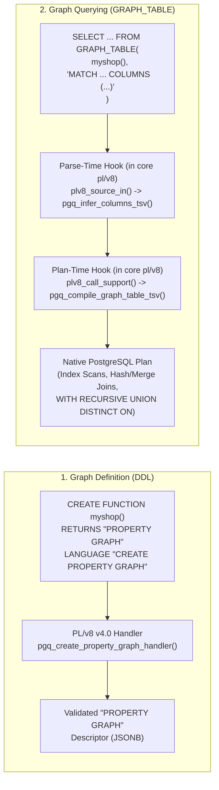

# Poor Man's SQL/PGQ (`pl-pgq` / `plpgq`) — Installation & Quickstart Guide

**Poor Man's SQL/PGQ (`plpgq`)** brings ISO/IEC 9075-16 (SQL/PGQ — Property Graph Queries) to PostgreSQL as a **100% self-contained, pure SQL/JS/WASM extension (zero C files, no `.so` module of its own)** built on top of **PL/v8 v4.0's custom language handler architecture** (`RETURNS language_handler LANGUAGE plv8`) and **PL/v8 v4.0's core table-macro & planner `prosupport` subsystem** (`plv8_source`, `SUPPORT plv8_call_support`, `plv8.register_column_inference`, `plv8.register_support`, `plv8.expected_columns`, `plv8.return_query`).

It provides two core capabilities without requiring any grammar patches to PostgreSQL or any custom C shared library in `pl-pgq`:

1. **`LANGUAGE "CREATE PROPERTY GRAPH"`**: A procedural language that takes a standard SQL/PGQ `CREATE PROPERTY GRAPH` clause (`VERTEX TABLES (...) EDGE TABLES (...)`) as the function body, validates it against the PostgreSQL system catalog, and returns a `"PROPERTY GRAPH"` (`property_graph`) catalog descriptor.
2. **`GRAPH_TABLE(pg, pattern)`**: A pure `LANGUAGE plv8` table function (`SUPPORT plv8_call_support`) usable directly in `FROM` clauses—**both without an `AS (...)` column list and with `AS (...)`**—that compiles `MATCH ... COLUMNS (...)` graph patterns into native PostgreSQL relational execution plans at query planning time.

---

## Architecture Overview



---

## 1. Prerequisites

| Component | Requirement | Purpose |
| :--- | :--- | :--- |
| **PostgreSQL** | PostgreSQL 18+ (`one-with-everything` branch recommended) | Provides `prosupport` planner hooks and `WITH RECURSIVE ... UNION DISTINCT ON (...)` for cyclic shortest/cheapest paths. |
| **PL/v8** | `plv8` v4.0.0+ | Provides `RETURNS language_handler LANGUAGE plv8`, `plv8_source`, `plv8_call_support`, `plv8.register_column_inference`, `plv8.register_support`, `plv8.expected_columns`, `plv8.return_query`, and `plv8.packages` / `plv8.modules`. |
| **Python 3** | `python3` | Used during build by [`build_bundle.py`](file:///google/src/cloud/hannuk/port_plv8_to_pljs/google3/%7Bscratch%7D/pl-pgq/scripts/build_bundle.py) to bundle the JS/Wasm compiler into `plpgq--1.0.sql`. |

---

## 2. Building & Installing

Because `pl-pgq` is a 100% pure SQL/JS/WASM package on top of `plv8`, no C compiler is required to build `pl-pgq`. From the [`pl-pgq`](file:///google/src/cloud/hannuk/port_plv8_to_pljs/google3/%7Bscratch%7D/pl-pgq/Makefile) directory, build and install the SQL/JS/WASM bundle using PGXS:

```bash
# Bundle src/*.js + Wasm into plpgq--1.0.sql
make PG_CONFIG=/path/to/pg_install/bin/pg_config

# Install control files and SQL bundle into share/postgresql/extension/
make PG_CONFIG=/path/to/pg_install/bin/pg_config install
```

> [!TIP]
> The [`Makefile`](file:///google/src/cloud/hannuk/port_plv8_to_pljs/google3/%7Bscratch%7D/pl-pgq/Makefile) installs three extension control files—[`plpgq.control`](file:///google/src/cloud/hannuk/port_plv8_to_pljs/google3/%7Bscratch%7D/pl-pgq/plpgq.control), [`pl_pgq.control`](file:///google/src/cloud/hannuk/port_plv8_to_pljs/google3/%7Bscratch%7D/pl-pgq/pl_pgq.control), and [`pl-pgq.control`](file:///google/src/cloud/hannuk/port_plv8_to_pljs/google3/%7Bscratch%7D/pl-pgq/pl-pgq.control)—so you can enable the extension using whichever naming convention you prefer.

### Enabling in a Database

Connect to your PostgreSQL database with `psql` and load `plv8` and `plpgq`:

```sql
CREATE EXTENSION IF NOT EXISTS plv8;
CREATE EXTENSION IF NOT EXISTS plpgq;
-- Or: CREATE EXTENSION IF NOT EXISTS "pl-pgq";
-- Or: CREATE EXTENSION IF NOT EXISTS pl_pgq;
```

Verify that the embedded WebAssembly character-classification kernel and JS compiler bundle are active inside V8:

```sql
SELECT pgq_wasm_active();
--  pgq_wasm_active 
-- -----------------
--  t
-- (1 row)
```

---

## 3. Running the Regression Test Suite

With a running PostgreSQL instance that has `plv8` and `plpgq` installed:

```bash
PGHOST=/tmp PGPORT=5432 make PG_CONFIG=/path/to/pg_install/bin/pg_config installcheck
```

Expected output:

```text
ok 1         - 01_create_property_graph                  191 ms
ok 2         - 02_graph_table_pg19                       196 ms
ok 3         - 03_quantified_shortest_paths              111 ms
ok 4         - 04_inlining_and_lateral                    58 ms
ok 5         - 05_security_roles                          55 ms
1..5
# All 5 tests passed.
```

---

## 4. Basic Usage (5-Minute Quickstart)

### Step 1: Create Underlying Relational Tables

Property graphs in SQL/PGQ are zero-copy views over existing relational tables, views, or partitioned tables:

```sql
CREATE TABLE customers (
  customer_id integer PRIMARY KEY,
  name varchar,
  address varchar
);

CREATE TABLE orders (
  order_id integer PRIMARY KEY,
  ordered_when date
);

CREATE TABLE products (
  product_no integer PRIMARY KEY,
  name varchar,
  price numeric
);

CREATE TABLE customer_orders (
  customer_orders_id integer PRIMARY KEY,
  customer_id integer REFERENCES customers (customer_id),
  order_id integer REFERENCES orders (order_id)
);

CREATE TABLE order_items (
  order_items_id integer PRIMARY KEY,
  order_id integer REFERENCES orders (order_id),
  product_no integer REFERENCES products (product_no),
  quantity integer
);

INSERT INTO customers VALUES (1, 'Customer1', 'US'), (2, 'Customer2', 'CA'), (3, 'Customer3', 'GL');
INSERT INTO orders VALUES (1, '2024-01-01'), (2, '2024-01-02'), (3, '2024-01-03');
INSERT INTO products VALUES (1, 'Product1', 100), (2, 'Product2', 200), (3, 'Product3', 300);
INSERT INTO customer_orders VALUES (1, 1, 1), (2, 2, 3);
INSERT INTO order_items VALUES (1, 1, 1, 5), (2, 1, 2, 10), (3, 2, 1, 7);
```

### Step 2: Define a Property Graph Function

Create a function returning `"PROPERTY GRAPH"` (or `property_graph`) using `LANGUAGE "CREATE PROPERTY GRAPH"` (or its lowercase/identifier aliases `"create property graph"`, `property_graph`, `sqlpgq_v8`).

Primary keys and foreign keys are automatically discovered from the PostgreSQL catalog when omitted:

```sql
CREATE FUNCTION myshop() RETURNS "PROPERTY GRAPH"
LANGUAGE "CREATE PROPERTY GRAPH" AS $$
  VERTEX TABLES (
    products,
    customers,
    orders
      DEFAULT LABEL
      LABEL lists
  )
  EDGE TABLES (
    order_items KEY (order_items_id)
      SOURCE KEY (order_id) REFERENCES orders
      DESTINATION KEY (product_no) REFERENCES products,
    customer_orders KEY (customer_orders_id)
      SOURCE KEY (customer_id) REFERENCES customers
      DESTINATION KEY (order_id) REFERENCES orders
  )
$$;
```

> [!NOTE]
> At `CREATE FUNCTION` time, the PL/v8 validator (`plv8_call_validator`) invokes the SQL/PGQ DDL parser to syntax-check the graph definition immediately. On first invocation (`myshop()`), the handler validates all table references, keys, labels, property types, typmods, and collations against `pg_catalog`.

### Step 3: Query the Graph with `GRAPH_TABLE`

Call `GRAPH_TABLE(myshop(), 'MATCH ... COLUMNS (...)')` inside any SQL `FROM` clause. You do **not** need to write an `AS (col type, ...)` clause—`plpgq` automatically infers the output column names and PostgreSQL types from your `COLUMNS (...)` clause at parse time!

```sql
-- Multi-hop traversal: Customers -> Orders -> Products
SELECT c_name, p_name, qty
  FROM GRAPH_TABLE(
    myshop(),
    'MATCH (c IS customers)-[IS customer_orders]->(o IS orders)-[oi IS order_items]->(p IS products)
     COLUMNS (c.name AS c_name, p.name AS p_name, oi.quantity AS qty)'
  )
 ORDER BY c_name, p_name;
```

Result:

```text
  c_name   |  p_name  | qty 
-----------+----------+-----
 Customer1 | Product1 |   5
 Customer1 | Product2 |  10
(2 rows)
```

You can also use standard `AS (...)` column aliases if desired:

```sql
SELECT *
  FROM GRAPH_TABLE(
    myshop(),
    'MATCH (c : customers WHERE c.address = ''US'') COLUMNS (c.name AS customer_name, c.address)'
  ) AS gt(customer_name varchar, address varchar);
```

### Step 4: Inspect the Native Execution Plan (`EXPLAIN`)

Because `graph_table` uses PL/v8 v4.0's core planner support hook ([`plv8_call_support`](file:///google/src/cloud/hannuk/port_plv8_to_pljs/google3/%7Bscratch%7D/plv8/plv8.cc#L7856-L8386)), `GRAPH_TABLE` is inlined into a native PostgreSQL `RTE_SUBQUERY` during query planning, so outer `WHERE` filters, index scans, and `LATERAL` joins push down directly into the underlying relational tables:

```sql
EXPLAIN (COSTS OFF)
SELECT c_name, p_name
  FROM GRAPH_TABLE(
    myshop(),
    'MATCH (c IS customers)-[IS customer_orders]->(o IS orders)-[oi IS order_items]->(p IS products)
     COLUMNS (c.customer_id AS cid, c.name AS c_name, p.name AS p_name)'
  )
 WHERE cid = 1;
```

---

## 5. Summary of Available Languages, Types, and Functions

| SQL Object | Signature / Aliases | Description |
| :--- | :--- | :--- |
| **Type** | `"PROPERTY GRAPH"`, `property_graph` | Domains over `jsonb` representing a validated SQL/PGQ property graph descriptor. |
| **Type** | `pgq_pattern` | Domain over `plv8_source` ([`plv8_source_in`](file:///google/src/cloud/hannuk/port_plv8_to_pljs/google3/%7Bscratch%7D/plv8/plv8.cc#L7532-L7652)) for automatic parse-time `COLUMNS (...)` type inference. |
| **Language** | `"CREATE PROPERTY GRAPH"`, `"create property graph"`, `property_graph`, `sqlpgq_v8` | PL/v8 v4.0 custom languages for defining property graphs via `CREATE FUNCTION` or `DO`. |
| **Function** | `GRAPH_TABLE(pg "PROPERTY GRAPH", pattern pgq_pattern)` | Primary SQL/PGQ query construct (`LANGUAGE plv8 STABLE SUPPORT plv8_call_support`); infers output columns automatically without `AS (...)` and inlines at plan time. |
| **Function** | `GRAPH_TABLE(pg "PROPERTY GRAPH", pattern pgq_pattern, params jsonb)` | Parameterized `GRAPH_TABLE` supporting `:named` and `$1` placeholders inside `MATCH`. |
| **Function** | `GRAPH_TABLE(pg "PROPERTY GRAPH", pattern text, row_type anyelement)` | Polymorphic `GRAPH_TABLE` returning rows shaped as `row_type` without `AS (...)`. |
| **Function** | `graph_table_jsonb(pg "PROPERTY GRAPH", pattern text [, params jsonb])` | Convenience SRF returning each matched graph row as a `jsonb` object. |

For an exhaustive walkthrough of all SQL/PGQ features, edge cases, shortest-path queries, `LATERAL` correlation, and security rules, see the [Detailed User Guide](file:///google/src/cloud/hannuk/port_plv8_to_pljs/google3/%7Bscratch%7D/pl-pgq/docs/USER_GUIDE.md).
