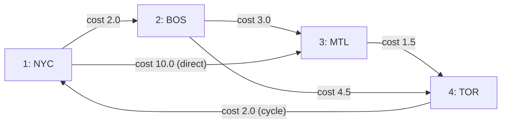

# Poor Man's SQL/PGQ (`pl-pgq` / `plpgq`) — Detailed User Guide

This guide walks through every feature of `plpgq`, organized directly around the five regression test suites in [`sql/`](file:///google/src/cloud/hannuk/port_plv8_to_pljs/google3/%7Bscratch%7D/pl-pgq/sql/01_create_property_graph.sql):

1. **[Defining Property Graphs (`01_create_property_graph.sql`)](#1-defining-property-graphs-01_create_property_graphsql)**
2. **[Querying with `GRAPH_TABLE` (`02_graph_table_pg19.sql`)](#2-querying-with-graph_table-02_graph_table_pg19sql)**
3. **[Quantified Paths, Shortest Paths & Cheapest Paths (`03_quantified_shortest_paths.sql`)](#3-quantified-paths-shortest-paths--cheapest-paths-03_quantified_shortest_pathssql)**
4. **[Planner Inlining, `LATERAL` Correlation & Parameterization (`04_inlining_and_lateral.sql`)](#4-planner-inlining-lateral-correlation--parameterization-04_inlining_and_lateralsql)**
5. **[Security Model & Role Permissions (`05_security_roles.sql`)](#5-security-model--role-permissions-05_security_rolessql)**

---

## 1. Defining Property Graphs ([`01_create_property_graph.sql`](file:///google/src/cloud/hannuk/port_plv8_to_pljs/google3/%7Bscratch%7D/pl-pgq/sql/01_create_property_graph.sql))

In `plpgq`, a property graph is defined as a PostgreSQL function returning `"PROPERTY GRAPH"` (or `property_graph`) written in `LANGUAGE "CREATE PROPERTY GRAPH"`.

### 1.1 Supported Language and Return-Type Aliases

You can use either the standard SQL/PGQ uppercase names or lowercase/identifier aliases:

| Return Type | Language Name | Function Body Style |
| :--- | :--- | :--- |
| `"PROPERTY GRAPH"` | `"CREATE PROPERTY GRAPH"` | Body begins directly with `VERTEX TABLES` / `NODE TABLES`, or includes a full `CREATE [TEMP] PROPERTY GRAPH <name>` header |
| `property_graph` | `"create property graph"` | Lowercase quoted alias |
| `property_graph` | `property_graph` | Unquoted SQL identifier alias |
| `"PROPERTY GRAPH"` | `sqlpgq_v8` | PL/v8 language alias |

Examples from [`01_create_property_graph.sql`](file:///google/src/cloud/hannuk/port_plv8_to_pljs/google3/%7Bscratch%7D/pl-pgq/sql/01_create_property_graph.sql#L47-L67):

```sql
CREATE FUNCTION g_alias_lower() RETURNS property_graph
LANGUAGE "create property graph" AS $$
  NODE TABLES (t1)
$$;

CREATE FUNCTION g_alias_ident() RETURNS property_graph
LANGUAGE property_graph AS $$
  VERTEX TABLES (t1)
$$;

CREATE FUNCTION g_alias_v8() RETURNS "PROPERTY GRAPH"
LANGUAGE sqlpgq_v8 AS $$
  CREATE PROPERTY GRAPH g_explicit_hdr
  VERTEX TABLES (t1)
$$;
```

When the `CREATE PROPERTY GRAPH <name>` header is omitted from the function body, `plpgq` automatically uses the PostgreSQL function name (`fn_Meta.proname`) as `graph_name`.

### 1.2 Primary Key & Foreign Key Auto-Discovery

When `KEY (...)` is omitted on a vertex or edge table, `plpgq` inspects `pg_constraint` (`contype = 'p'`) to discover the table's primary key—including composite primary keys. Similarly, when `SOURCE <vertex_table>` or `DESTINATION <vertex_table>` is specified without `KEY (...) REFERENCES ...`, `plpgq` discovers the single foreign key (`contype = 'f'`) linking the edge table to the vertex table:

```sql
CREATE TABLE t1 (a int PRIMARY KEY, b text, c numeric);
CREATE TABLE t3 (x int, y int, z text, PRIMARY KEY (x, y));
CREATE TABLE t4 (
  id int PRIMARY KEY,
  t1_a int REFERENCES t1(a),
  t3_x int,
  t3_y int,
  w int,
  FOREIGN KEY (t3_x, t3_y) REFERENCES t3(x, y)
);

CREATE FUNCTION g_minimal() RETURNS "PROPERTY GRAPH"
LANGUAGE "CREATE PROPERTY GRAPH" AS $$
  VERTEX TABLES (t1, t3)
  EDGE TABLES (
    t4 SOURCE t1 DESTINATION t3
  )
$$;
```

### 1.3 Labels, Property Clauses, and Computed Expression Properties

Each vertex or edge table (and `NODE TABLES` / `RELATIONSHIP TABLES` synonyms) supports:
- **Table aliases**: `t2 AS v_t2` (allowing the same physical table `t2` to appear multiple times, e.g., both as a vertex table `v_t2` and an edge table `e_t2`).
- **Explicit keys**: `KEY (a)` or composite `KEY (x, y)`.
- **Explicit endpoint references**: `SOURCE KEY (i) REFERENCES t2 (i) DESTINATION KEY (j) REFERENCES t1 (a)`.
- **Label definitions**:
  - Implicit default label (named after the element alias or table name) when no label clause is written.
  - `DEFAULT LABEL` (explicitly includes the default label alongside additional `LABEL <name>` clauses).
  - Multiple `LABEL <label_name>` clauses per element table.
- **Property definitions per label**:
  - `PROPERTIES ALL COLUMNS` (the default when `PROPERTIES` is omitted)
  - `PROPERTIES ALL COLUMNS EXCEPT (col1, col2)`
  - `PROPERTIES (col1, expr AS alias, ...)` — supports arbitrary scalar SQL expressions over the element table's columns (such as `upper(b) AS b_up` or `id1 + id2 AS id`)
  - `NO PROPERTIES`

Example from [`01_create_property_graph.sql`](file:///google/src/cloud/hannuk/port_plv8_to_pljs/google3/%7Bscratch%7D/pl-pgq/sql/01_create_property_graph.sql#L70-L90):

```sql
CREATE FUNCTION g_rich() RETURNS "PROPERTY GRAPH"
LANGUAGE "CREATE PROPERTY GRAPH" AS $$
  VERTEX TABLES (
    t1 KEY (a)
      DEFAULT LABEL
      LABEL l_basic PROPERTIES (a, upper(b) AS b_up)
      LABEL l_extra PROPERTIES (c AS score),
    t2 AS v_t2 KEY (i)
      PROPERTIES ALL COLUMNS EXCEPT (j),
    t3 KEY (x, y)
      NO PROPERTIES
  )
  RELATIONSHIP TABLES (
    t2 AS e_t2 KEY (i)
      SOURCE KEY (i) REFERENCES t2 (i)
      DESTINATION KEY (j) REFERENCES t1 (a)
      LABEL links_to NO PROPERTIES
  )
$$;
```

Inspecting `(g_rich())::jsonb -> 'property_types'` shows how `plpgq` resolves the exact PostgreSQL type OID, formatted SQL type, `typmod`, and `collation` of every property (including computed expressions like `upper(b) AS b_up`):

```json
{
    "a":     { "type_oid": 23,   "type_sql": "integer", "typmod": -1, "collation_oid": 0 },
    "b":     { "type_oid": 25,   "type_sql": "text",    "typmod": -1, "collation_oid": 100 },
    "b_up":  { "type_oid": 25,   "type_sql": "text",    "typmod": -1, "collation_oid": 100 },
    "score": { "type_oid": 1700, "type_sql": "numeric", "typmod": -1, "collation_oid": 0 }
}
```

### 1.4 Temporary and Unlogged Table Rules

- Referencing a `TEMP` table automatically marks the property graph descriptor with `"is_temporary": true`.
- Referencing an `UNLOGGED` table in a persistent property graph raises `ERROR: cannot use unlogged table "..." in a persistent property graph` (`42P16`), matching PostgreSQL 19 `create_property_graph.sql`.
- Specifying `CREATE TEMP PROPERTY GRAPH ...` inside the function body allows `UNLOGGED` tables to be included.

### 1.5 DDL Semantic Validation Reference

`plpgq` enforces all 18 semantic validation rules from PostgreSQL 19's `create_property_graph.sql`:

| Condition | SQLSTATE | Error Message Example |
| :--- | :--- | :--- |
| Empty graph (no vertex or edge tables) | `42601` | `syntax error: CREATE PROPERTY GRAPH requires at least VERTEX TABLES (...) or EDGE TABLES (...)` |
| Unlogged table in persistent graph | `42P16` | `cannot use unlogged table "unlogged_v" in a persistent property graph` |
| Missing `KEY` on table without PK | `42P16` | `KEY clause is required for element table "no_pk_v" because relation "no_pk_v" has no primary key` |
| Duplicate element table alias | `42712` | `duplicate element table alias "t1" in property graph` |
| Duplicate label on same element table | `42710` | `label "l1" specified more than once for element table "t1"` |
| Non-existent column in `EXCEPT (...)` | `42703` | `column "nonexistent_col" in EXCEPT list does not exist in relation "t1"` |
| Duplicate property within a label | `42701` | `property "a" specified more than once for label "l1"` |
| Expression property without `AS alias` | `42601` | `syntax error: property expression "a + 1" requires an AS alias` |
| Same property defined with different expressions across two labels on the same table | `42P16` | `property "p1" on element table "t1" has mismatching expressions across labels` |
| Property data type mismatch across tables/labels | `42804` | `property "common_prop" has mismatching data types (integer vs text)` |
| Property `typmod` mismatch across tables/labels | `42804` | `property "code" has mismatching type modifiers (character varying(5) vs character varying(10))` |
| Property collation mismatch across tables/labels | `42P22` | `property "name" has mismatching collations across element tables` |
| Missing FK when `SOURCE`/`DESTINATION` omits `KEY` | `42704` | `no foreign key found between edge table "t2" and vertex table "t3"` |
| Multiple FKs between edge and vertex table without explicit `KEY` | `42725` | `more than one foreign key found between edge table "multi_fk_e" and vertex table "t1"; specify SOURCE KEY (...) explicitly` |
| Endpoint key column count mismatch | `42830` | `number of source/destination key columns (1) does not match number of referenced vertex key columns (2)` |
| Endpoint key column type mismatch | `42804` | `foreign key column "k" (text) and referenced column "a" (integer) are of incompatible types` |
| Aggregate in property expression | `42803` | `invalid property expression "count(a)" on relation "t1": aggregate functions are not allowed in FROM clause of their own query level` |

---

## 2. Querying with `GRAPH_TABLE` ([`02_graph_table_pg19.sql`](file:///google/src/cloud/hannuk/port_plv8_to_pljs/google3/%7Bscratch%7D/pl-pgq/sql/02_graph_table_pg19.sql))

### 2.1 Querying Without `AS (...)` vs. With `AS (...)`

Standard PostgreSQL functions returning `SETOF record` normally require an explicit `AS (col1 type1, ...)` column definition list in the `FROM` clause. `plpgq` eliminates this boilerplate: the `pgq_pattern` domain's input function ([`plpgq_pattern_in`](file:///google/src/cloud/hannuk/port_plv8_to_pljs/google3/%7Bscratch%7D/pl-pgq/plpgq.c#L329-L410)) inspects the query during parse analysis, infers the output column names and types from `COLUMNS (...)`, and registers them on the function call before `addRangeTableEntryForFunction` checks the return tuple descriptor.

Both forms work interchangeably for both single-column and multi-column projections:

```sql
-- Without AS (...) — single column
SELECT customer_name
  FROM GRAPH_TABLE(myshop(), 'MATCH (c IS customers) COLUMNS (c.name AS customer_name)')
 ORDER BY customer_name;

-- Without AS (...) — multi-column
SELECT customer_name, ordered_when
  FROM GRAPH_TABLE(
    myshop(),
    'MATCH (c IS customers)-[co IS customer_orders]->(o IS orders WHERE o.ordered_when = date ''2024-01-01'')
     COLUMNS (c.name AS customer_name, o.ordered_when)'
  );

-- With explicit AS (...) table & column alias
SELECT *
  FROM GRAPH_TABLE(
    myshop(),
    'MATCH (c : customers WHERE c.address = ''US'') COLUMNS (c.name AS customer_name, c.address)'
  ) AS gt(customer_name varchar, address varchar);
```

### 2.2 Vertex and Edge Pattern Syntax

`MATCH` supports full and abbreviated edge patterns in any direction:

| Pattern Syntax | Meaning | Example |
| :--- | :--- | :--- |
| `(v IS label WHERE pred)` or `(v : label WHERE pred)` | Vertex pattern (`IS` and `:` are synonymous) | `(c IS customers WHERE c.address = 'US')` |
| `-[e IS label WHERE pred]->` | Directed right edge with variable and label | `-[oi IS order_items]->` |
| `->` | Abbreviated directed right edge (matches any edge label) | `(a)->(b)` |
| `<-[e IS label WHERE pred]-` | Directed left edge with variable and label | `(o IS orders)<-[IS customer_orders]-(c IS customers)` |
| `<-` | Abbreviated directed left edge | `(a)<-(b)` |
| `-[e IS label WHERE pred]-` | Undirected edge (matches traversal in either direction) | `(a IS v1)-[b IS e1_2_1]-(c)` |
| `-` | Abbreviated undirected edge | `(a)-(b)` |

### 2.3 Label Expressions (`|`, `&`, `!`, `%`) and SQL/PGQ Section 6.5 Property Resolution

Element patterns support boolean label expressions:
- **Disjunction (`|`)**: `(n IS customers | products)` or `(a IS vl1 | vl2)`
- **Conjunction (`&`)**: `(n IS orders & lists)`
- **Negation (`!`)**: `(n IS !products)`
- **Wildcard (`%`)**: `(n IS %)` (matches any label of that element kind)

#### Multi-Label Property Resolution (`g1` in [`02_graph_table_pg19.sql`](file:///google/src/cloud/hannuk/port_plv8_to_pljs/google3/%7Bscratch%7D/pl-pgq/sql/02_graph_table_pg19.sql#L110-L201))

Per ISO/IEC 9075-16 Section 6.5, when an element variable is qualified by a label expression `(a IS vl1 | vl2)`:
1. An element table matches if it satisfies the boolean label expression.
2. Any property defined on **any** label referenced in the label expression (`vl1` exposes `id, vprop1`; `vl2` exposes `vprop2`) is accessible on `a`.
3. For each matching element table `T`, if `T` defines that property on **any** of `T`'s labels (even a label not mentioned in the query's `IS` clause, or via a computed expression like `id1 + id2 AS id`), `T`'s expression is projected; otherwise, a typed `NULL` (`NULL::integer`) is projected for that branch of the `UNION ALL`:

```sql
-- v1 has labels vl1 (id, vprop1) and vl2 (vprop2)
-- v2 has composite key (id1, id2), label vl1 (id1 + id2 AS id, vprop1), and label vl3 (vprop3)
-- v3 has label vl2 (vprop2)
SELECT id, vprop1, vprop2
  FROM GRAPH_TABLE(g1(), 'MATCH (a IS vl1 | vl2) COLUMNS (a.id, a.vprop1, a.vprop2)')
 ORDER BY id NULLS LAST, vprop1 NULLS LAST, vprop2;
```

Result:

```text
 id | vprop1 | vprop2 
----+--------+--------
  1 |     10 |    100
  1 |        |    200
  2 |     10 |       
  2 |   2000 |    200
  2 |        |    500
  3 |     20 |       
(6 rows)
```

### 2.4 Cyclic Path Patterns and Undirected Self-Loops (`g2` in [`02_graph_table_pg19.sql`](file:///google/src/cloud/hannuk/port_plv8_to_pljs/google3/%7Bscratch%7D/pl-pgq/sql/02_graph_table_pg19.sql#L212-L258))

When the same element variable (`a` or `b`) appears multiple times in a `MATCH` pattern, `plpgq` enforces **element identity equality** across all occurrences of that variable—comparing both the element table OID (`__elem_oid`) and all primary key columns:

- **Cyclic vertex pattern `(a)->(b)->(a)`**: Starts at vertex `a`, traverses to `b`, and returns to the exact same vertex `a` (even across heterogeneous vertex tables `n1`, `n2`, `n3` and edge tables `en1n2`, `en2n1`, `en1n1`):
  ```sql
  SELECT aname, bname
    FROM GRAPH_TABLE(g2(), 'MATCH (a)->(b)->(a) COLUMNS (a.name AS aname, b.name AS bname)')
   ORDER BY aname, bname;
  --  aname | bname 
  -- -------+-------
  --  n1_1  | n1_1
  --  n1_2  | n2_1
  --  n1_2  | n2_3
  --  n2_1  | n1_2
  --  n2_3  | n1_2
  -- (5 rows)
  ```
- **Repeated vertex and edge variable `(a)-[b]->(a)-[b]->(a)`**: Both vertex `a` and edge `b` must be identical in both hops (matching only self-loop edges):
  ```sql
  SELECT aname, bname
    FROM GRAPH_TABLE(g2(), 'MATCH (a)-[b]->(a)-[b]->(a) COLUMNS (a.name AS aname, b.ename AS bname)');
  --  aname | bname  
  -- -------+--------
  --  n1_1  | e11_11
  -- (1 row)
  ```
- **Undirected self-loop `(a)-[c]-(a)`**: An undirected edge expands into forward and reverse traversals, with a deduplication guard (`NOT (src = dst)` on the reverse branch) so self-loops are emitted once rather than twice:
  ```sql
  SELECT aname, cname
    FROM GRAPH_TABLE(g2(), 'MATCH (a)-[c]-(a) COLUMNS (a.name AS aname, c.ename AS cname)');
  --  aname | cname  
  -- -------+--------
  --  n1_1  | e11_11
  -- (1 row)
  ```

### 2.5 Table Inheritance, Views, and Prepared Statements

Because `plpgq` compiles graph patterns into standard SQL table references over your schema relations:
- **Table Inheritance & Partitioned Tables**: A vertex or edge table that is an inheritance parent (`pv_parent`) or partitioned table automatically scans child tables (`pv_child`) seamlessly ([`02_graph_table_pg19.sql`](file:///google/src/cloud/hannuk/port_plv8_to_pljs/google3/%7Bscratch%7D/pl-pgq/sql/02_graph_table_pg19.sql#L259-L280)).
- **Views (`CREATE VIEW`)**: Queries using `GRAPH_TABLE` can be saved inside standard PostgreSQL views (`CREATE VIEW shop_customer_orders_v AS SELECT ... FROM GRAPH_TABLE(...)`).
- **Prepared Statements (`PREPARE` / `EXECUTE`)**: Parameterized queries (`WHERE customer_name = $1`) work seamlessly with `PREPARE` and `EXECUTE` even without an `AS (...)` clause ([`02_graph_table_pg19.sql`](file:///google/src/cloud/hannuk/port_plv8_to_pljs/google3/%7Bscratch%7D/pl-pgq/sql/02_graph_table_pg19.sql#L288-L294)):
  ```sql
  PREPARE pq_shop(varchar) AS
    SELECT customer_name, ordered_when
      FROM GRAPH_TABLE(
        myshop(),
        'MATCH (c IS customers)-[IS customer_orders]->(o IS orders)
         COLUMNS (c.name AS customer_name, o.ordered_when)'
      )
     WHERE customer_name = $1;

  EXECUTE pq_shop('Customer1');
  --  customer_name | ordered_when 
  -- ---------------+--------------
  --  Customer1     | 01-01-2024
  ```

### 2.6 `GRAPH_TABLE` Negative Validation Reference

[`02_graph_table_pg19.sql`](file:///google/src/cloud/hannuk/port_plv8_to_pljs/google3/%7Bscratch%7D/pl-pgq/sql/02_graph_table_pg19.sql#L296-L339) verifies all compile-time error checks for invalid `GRAPH_TABLE` invocations:

| Error Condition | SQLSTATE | Error Message |
| :--- | :--- | :--- |
| Non-existent graph name | `42704` | `property graph "nonexistent_graph" does not exist` |
| Relation name is a table, not a property graph | `42809` | `"customers" is not a property graph` |
| Adjacent vertices without an edge `(a)(b)` | `42601` | `syntax error: consecutive vertex patterns without an intervening edge pattern` |
| Adjacent edges without a vertex `(a)->->(b)` | `42601` | `syntax error: consecutive edge patterns without an intervening vertex pattern` |
| Dangling edge at end of path `(a)->` | `42601` | `syntax error: edge pattern at end of path lacks destination vertex pattern` |
| Star projection `c.*` in `COLUMNS` | `0A000` | `SELECT * (all properties) in GRAPH_TABLE COLUMNS is not supported` |
| Aggregate in unquantified `COLUMNS` | `42803` | `aggregate functions are not allowed in GRAPH_TABLE COLUMNS` |
| Window function in `COLUMNS` | `42P20` | `window functions are not allowed in GRAPH_TABLE COLUMNS` |
| Unknown label in `IS` clause | `42704` | `label "unknown_label" does not exist in property graph "myshop"` |
| Edge-only label used on a vertex | `42809` | `label "customer_orders" is only associated with edges and cannot qualify a vertex` |
| Unknown property on element variable | `42703` | `property "nonexistent_prop" does not exist on element variable "c"` |
| Referencing outer element variable inside an element pattern's local `WHERE` | `42P10` | `cannot reference non-local element variable "c" in element pattern WHERE clause` (use the path-level `WHERE` after the pattern instead) |
| Same variable bound to both vertex and edge `(a)-[a]->(b)` | `42P10` | `element variable "a" cannot be bound to both a vertex and an edge` |

---

## 3. Quantified Paths, Shortest Paths & Cheapest Paths ([`03_quantified_shortest_paths.sql`](file:///google/src/cloud/hannuk/port_plv8_to_pljs/google3/%7Bscratch%7D/pl-pgq/sql/03_quantified_shortest_paths.sql))

`plpgq` compiles variable-length path patterns and shortest/cheapest path selectors into recursive CTEs leveraging the PostgreSQL `one-with-everything` branch's **`WITH RECURSIVE ... UNION DISTINCT ON (__src_key, __dst_key)`** construct for cycle-safe reachability and pruning.

### 3.1 Example Cyclic Transit Graph



```sql
CREATE FUNCTION transit_graph() RETURNS "PROPERTY GRAPH"
LANGUAGE "CREATE PROPERTY GRAPH" AS $$
  VERTEX TABLES (
    cities LABEL city PROPERTIES ALL COLUMNS
  )
  EDGE TABLES (
    routes
      SOURCE KEY (src) REFERENCES cities
      DESTINATION KEY (dst) REFERENCES cities
      LABEL route PROPERTIES ALL COLUMNS
  )
$$;
```

### 3.2 Path Quantifiers (`+`, `*`, `?`, `{m,n}`) and Path Aggregates

Quantifiers can be attached directly to an edge pattern (`-[r IS route]->{1,2}`) or to a parenthesized sub-path (`((a IS city)-[r IS route]->(b IS city)){1,2}`).

Inside `COLUMNS (...)`, quantified paths expose path-level aggregate functions:
- `count(r)` or `path_length()`: Number of hops (`bigint`) in the matched path.
- `path_cost()` or `path_weight()`: Total accumulated weight (`numeric`) of the matched path (automatically summed from the edge's `cost` / `weight` / `distance` property).

#### Bounded Quantifier `{1,2}`

```sql
SELECT origin, dest, hops, cost
  FROM GRAPH_TABLE(
    transit_graph(),
    'MATCH (a IS city)-[r IS route]->{1,2}(b IS city)
     WHERE a.name = ''NYC''
     COLUMNS (a.name AS origin, b.name AS dest, count(r) AS hops, path_cost() AS cost)'
  )
 ORDER BY hops, dest, cost;
```

Result:

```text
 origin | dest | hops | cost 
--------+------+------+------
 NYC    | BOS  |    1 |  2.0
 NYC    | MTL  |    1 | 10.0
 NYC    | MTL  |    2 |  5.0
 NYC    | TOR  |    2 |  6.5
 NYC    | TOR  |    2 | 11.5
(5 rows)
```

#### Optional 0-or-1 Hop Quantifier `?`

Includes the 0-hop reflexive path (`NYC -> NYC` with `hops = 0`) plus 1-hop neighbors:

```sql
SELECT origin, dest, hops
  FROM GRAPH_TABLE(
    transit_graph(),
    'MATCH (a IS city)-[r IS route]->?(b IS city)
     WHERE a.name = ''NYC''
     COLUMNS (a.name AS origin, b.name AS dest, path_length() AS hops)'
  )
 ORDER BY hops, dest;
--  origin | dest | hops 
-- --------+------+------
--  NYC    | NYC  |    0
--  NYC    | BOS  |    1
--  NYC    | MTL  |    1
-- (3 rows)
```

### 3.3 `ANY SHORTEST`, `ALL SHORTEST`, and `ANY CHEAPEST`

| Path Mode | Semantics | Generated CTE Strategy |
| :--- | :--- | :--- |
| `MATCH ANY SHORTEST (a)-[r]->+(b)` | Returns one minimum-hop path per `(src, dst)` pair | `WITH RECURSIVE __pgq_paths AS (... UNION DISTINCT ON (__src_key, __dst_key) ...)` |
| `MATCH ALL SHORTEST (a)-[r]->+(b)` | Returns **all** tied minimum-hop paths per `(src, dst)` pair | Cycle-safe recursive expansion with `NOT (key = ANY(__visited))` filtered by `rank() OVER (PARTITION BY __src_key, __dst_key ORDER BY __hop_count ASC) = 1` |
| `MATCH ANY CHEAPEST (a)-[r]->+(b)` | Returns one minimum-cost path per `(src, dst)` pair | Cycle-safe recursive expansion + `DISTINCT ON (__src_key, __dst_key) ... ORDER BY __src_key, __dst_key, __path_cost ASC, __hop_count ASC` |
| `MATCH ALL CHEAPEST (a)-[r]->+(b)` | Returns **all** tied minimum-cost paths per `(src, dst)` pair | Filtered by `rank() OVER (PARTITION BY __src_key, __dst_key ORDER BY __path_cost ASC) = 1` |

#### Comparing `ANY SHORTEST`, `ALL SHORTEST`, and `ANY CHEAPEST` on `transit_graph()`

1. **`ANY SHORTEST`** (minimum hops; `NYC -> MTL` takes the 1-hop direct edge, `NYC -> TOR` takes 2 hops):
   ```sql
   SELECT origin, dest, hops
     FROM GRAPH_TABLE(
       transit_graph(),
       'MATCH ANY SHORTEST (a IS city)-[r IS route]->+(b IS city)
        WHERE a.name = ''NYC''
        COLUMNS (a.name AS origin, b.name AS dest, count(r) AS hops)'
     )
    ORDER BY dest;
   --  origin | dest | hops 
   -- --------+------+------
   --  NYC    | BOS  |    1
   --  NYC    | MTL  |    1
   --  NYC    | TOR  |    2
   ```

2. **`ALL SHORTEST`** (returns **both** 2-hop shortest paths to `TOR`: `NYC -> BOS -> TOR` at cost `6.5` and `NYC -> MTL -> TOR` at cost `11.5`):
   ```sql
   SELECT origin, dest, hops, cost
     FROM GRAPH_TABLE(
       transit_graph(),
       'MATCH ALL SHORTEST (a IS city)-[r IS route]->+(b IS city)
        WHERE a.name = ''NYC''
        COLUMNS (a.name AS origin, b.name AS dest, count(r) AS hops, path_cost() AS cost)'
     )
    ORDER BY dest, cost;
   --  origin | dest | hops | cost 
   -- --------+------+------+------
   --  NYC    | BOS  |    1 |  2.0
   --  NYC    | MTL  |    1 | 10.0
   --  NYC    | TOR  |    2 |  6.5
   --  NYC    | TOR  |    2 | 11.5
   ```

3. **`ANY CHEAPEST`** (chooses the 2-hop `NYC -> BOS -> MTL` path with total cost `5.0` instead of the 1-hop `NYC -> MTL` path with cost `10.0`):
   ```sql
   SELECT origin, dest, hops, total_cost
     FROM GRAPH_TABLE(
       transit_graph(),
       'MATCH ANY CHEAPEST (a IS city)-[r IS route]->+(b IS city)
        WHERE a.name = ''NYC''
        COLUMNS (a.name AS origin, b.name AS dest, count(r) AS hops, path_weight() AS total_cost)'
     )
    ORDER BY dest;
   --  origin | dest | hops | total_cost 
   -- --------+------+------+------------
   --  NYC    | BOS  |    1 |        2.0
   --  NYC    | MTL  |    2 |        5.0
   --  NYC    | TOR  |    2 |        6.5
   ```

---

## 4. Planner Inlining, `LATERAL` Correlation & Parameterization ([`04_inlining_and_lateral.sql`](file:///google/src/cloud/hannuk/port_plv8_to_pljs/google3/%7Bscratch%7D/pl-pgq/sql/04_inlining_and_lateral.sql))

### 4.1 Zero-Overhead Planner Inlining (`SupportRequestInlineInFrom`)

When PostgreSQL plans a query containing `GRAPH_TABLE(...)`, [`plpgq_graph_table_support`](file:///google/src/cloud/hannuk/port_plv8_to_pljs/google3/%7Bscratch%7D/pl-pgq/plpgq.c#L604-L746) intercepts `SupportRequestInlineInFrom` and replaces the function call with a native `Query *` (`RTE_SUBQUERY`), which PostgreSQL's planner then pulls up into the parent query.

As shown in [`04_inlining_and_lateral.sql`](file:///google/src/cloud/hannuk/port_plv8_to_pljs/google3/%7Bscratch%7D/pl-pgq/sql/04_inlining_and_lateral.sql#L49-L66), there is **no `Function Scan on graph_table`** in the plan, and an outer `WHERE sender_id = 1` predicate pushes all the way down into an `Index Only Scan using accounts_pkey`:

```sql
EXPLAIN (COSTS OFF)
SELECT receiver, amount
  FROM GRAPH_TABLE(
    fin_graph(),
    'MATCH (s IS account)-[t IS transfer]->(r IS account)
     COLUMNS (s.acc_id AS sender_id, r.owner AS receiver, t.amount)'
  )
 WHERE sender_id = 1
 ORDER BY receiver;
```

Plan output:

```text
                            QUERY PLAN                            
------------------------------------------------------------------
 Sort
   Sort Key: __f2.owner
   ->  Nested Loop
         ->  Index Only Scan using accounts_pkey on accounts __f0
               Index Cond: (acc_id = 1)
         ->  Hash Join
               Hash Cond: (__f2.acc_id = __f1.to_acc)
               ->  Seq Scan on accounts __f2
               ->  Hash
                     ->  Seq Scan on transfers __f1
                           Filter: (from_acc = 1)
(11 rows)
```

### 4.2 `LATERAL` Correlation with Outer Tables in `FROM`

Inside a `MATCH ... WHERE ...` or `COLUMNS (...)` clause, you can directly reference columns from preceding tables in the `FROM` clause (such as `w.target_owner` and `w.min_amt` below).

[`plpgq_graph_table_support`](file:///google/src/cloud/hannuk/port_plv8_to_pljs/google3/%7Bscratch%7D/pl-pgq/plpgq.c#L604-L746) collects all in-scope range table entries (`root->parse->rtable`) at `varlevelsup = 1`, allows the SQL compiler to leave outer table references untouched, and enables the PostgreSQL optimizer to turn the correlated `GRAPH_TABLE` into a native `Merge Join` or `Hash Join` across the entire query:

```sql
CREATE TABLE watch_list (target_owner text, min_amt numeric);
INSERT INTO watch_list VALUES ('Alice', 300.00), ('Bob', 100.00);

SELECT w.target_owner, gt.receiver, gt.amount
  FROM watch_list w,
       GRAPH_TABLE(
         fin_graph(),
         'MATCH (s IS account)-[t IS transfer]->(r IS account)
          WHERE s.owner = w.target_owner AND t.amount >= w.min_amt
          COLUMNS (r.owner AS receiver, t.amount)'
       ) gt
 ORDER BY w.target_owner, gt.receiver;
```

Result:

```text
 target_owner | receiver | amount 
--------------+----------+--------
 Alice        | Carol    | 500.00
 Bob          | Carol    | 125.00
(2 rows)
```

### 4.3 Parameterized Overloads (`params jsonb`) and `graph_table_jsonb`

When passing dynamic parameters via a `jsonb` object or array, use the 3-argument `GRAPH_TABLE(pg, pattern, params)` overload or `graph_table_jsonb(pg, pattern, params)`:

- **Named parameters (`:param_name`) with a `jsonb` object**:
  ```sql
  SELECT receiver, amount
    FROM GRAPH_TABLE(
      fin_graph(),
      'MATCH (s IS account)-[t IS transfer]->(r IS account)
       WHERE s.owner = :owner_name
       COLUMNS (r.owner AS receiver, t.amount)',
      '{"owner_name": "Alice"}'::jsonb
    ) AS gt(receiver text, amount numeric)
   ORDER BY amount;
  ```
- **Positional parameters (`$1`, `$2`) with a `jsonb` array and `graph_table_jsonb`**:
  ```sql
  SELECT row_data
    FROM graph_table_jsonb(
      fin_graph(),
      'MATCH (s IS account)-[t IS transfer]->(r IS account)
       WHERE s.owner = $1
       COLUMNS (r.owner AS receiver, t.amount)',
      '["Bob"]'::jsonb
    ) AS row_data;
  --                row_data               
  -- --------------------------------------
  --  {"amount": 125, "receiver": "Carol"}
  ```

---

## 5. Security Model & Role Permissions ([`05_security_roles.sql`](file:///google/src/cloud/hannuk/port_plv8_to_pljs/google3/%7Bscratch%7D/pl-pgq/sql/05_security_roles.sql))

`plpgq` is designed for safe multi-tenant and non-superuser operation:

1. **Trusted Language (`lanpltrusted = true`)**:
   - `LANGUAGE "CREATE PROPERTY GRAPH"` (and its aliases) is marked as a trusted procedural language with `GRANT USAGE ON LANGUAGE ... TO PUBLIC`, so ordinary database users with `CREATE` privileges on a schema can define property graphs without superuser rights.
2. **Internal Compiler Helpers Locked Down (`REVOKE ALL ... FROM PUBLIC`)**:
   - Internal PL/v8 compiler entrypoints (`pgq_compiler_bundle()`, `pgq_infer_columns_tsv(...)`, `pgq_compile_graph_table_tsv(...)`, `pgq_language_handler()`, `plpgq_graph_table_support(internal)`) have `PUBLIC` execute permissions revoked. Direct SQL calls by unprivileged roles fail with `ERROR: permission denied for function ...`.
3. **Standard PostgreSQL Table ACL Enforcement (`SECURITY INVOKER`)**:
   - Because `GRAPH_TABLE` inlines into a standard `RTE_SUBQUERY` (or executes via `SPI_execute` in the caller's security context), PostgreSQL's native permission checks (`ACL_SELECT`) and Row-Level Security (RLS) policies apply to every underlying vertex and edge table.
   - Granting `EXECUTE` on a property graph function (`GRANT EXECUTE ON FUNCTION secret_graph() TO regress_pgq_unpriv`) does **not** bypass table permissions on `secret_nodes`:

```sql
SET ROLE regress_pgq_unpriv;

-- Fails because regress_pgq_unpriv does not have SELECT on secret_nodes:
SELECT secret
  FROM GRAPH_TABLE(
    secret_graph(),
    'MATCH (s IS secret_nodes) COLUMNS (s.secret)'
  ) AS gt(secret text);
-- ERROR:  permission denied for table secret_nodes
```
