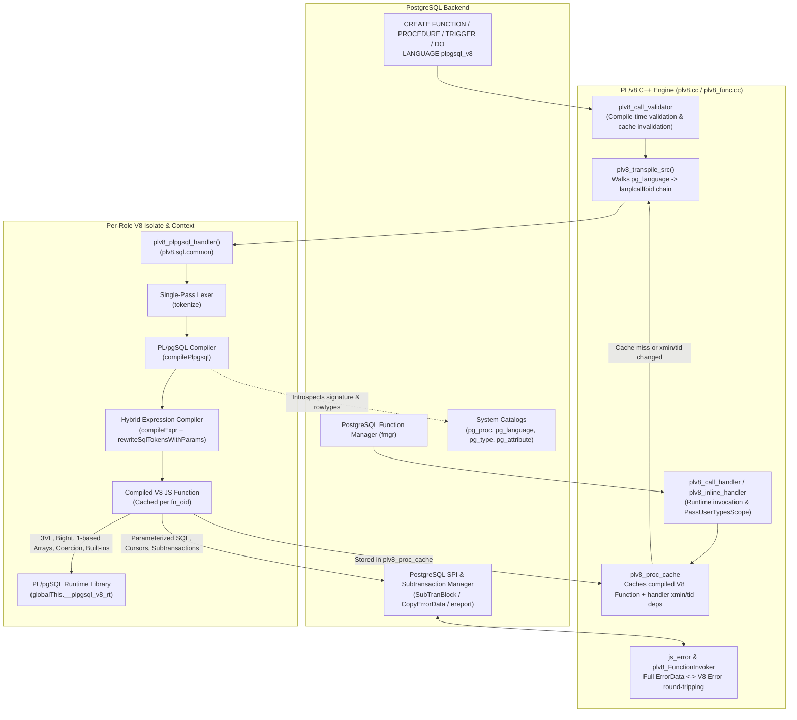
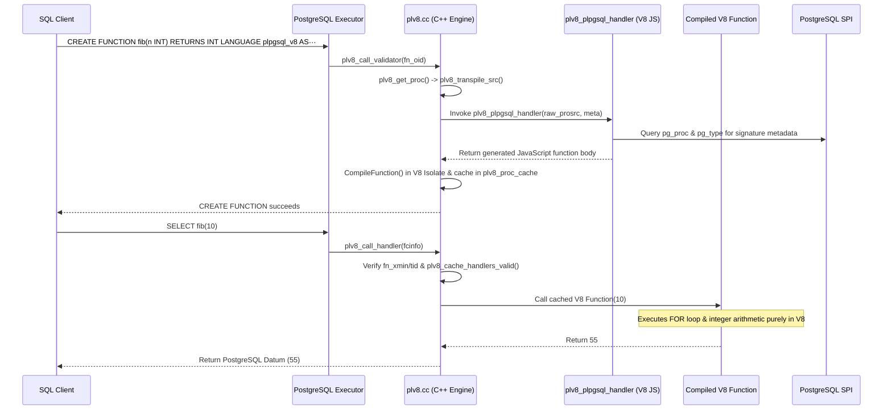

<!-- disableFinding(LINE_OVER_80) -->
<!-- disableFinding(HEADING_FUNCTION) -->

# PL/pgSQL+V8 (`plpgsql_v8`) High-Level Design

## 1. Executive Summary

**PL/pgSQL+V8** (`plpgsql_v8`) is a trusted PostgreSQL procedural language built on top of `plv8` that compiles standard **PostgreSQL PL/pgSQL** functions (scalar, `OUT`/`INOUT`, and set-returning), stored procedures (`CALL`), triggers (`NEW`, `OLD`, `TG_*`), and inline `DO` blocks into native **V8 JavaScript**.

In PostgreSQL's built-in `plpgsql` interpreter, procedural control flow walks an interpreted AST and frequently delegates scalar expressions and loop bounds to the PostgreSQL Server Programming Interface (SPI). By contrast, `plpgsql_v8` compiles PL/pgSQL procedural blocks, variable assignments, 64-bit `bigint` arithmetic, three-valued boolean logic, 1-based array indexing/slicing, composite field manipulation, and common SQL scalar built-ins directly into V8 JavaScript, while routing static/dynamic SQL, cursors, and subtransactions (`BEGIN ... EXCEPTION WHEN ... END`) through `plv8`'s SPI and subtransaction bindings.

---

## 2. Goals and Non-Goals

### 2.1 Goals

1. **Drop-In PL/pgSQL Compatibility**: Support standard PL/pgSQL syntax and semantics:
   - Nested blocks (`DECLARE ... BEGIN ... EXCEPTION ... END`) with `<<label>>` qualification and variable shadowing.
   - Declarations: `CONSTANT`, `NOT NULL`, `COLLATE`, `DEFAULT` / `:=` / `=`, `ALIAS FOR`, `%TYPE`, `%ROWTYPE`, composite types, `RECORD`, `CURSOR (params) FOR ...`, and `refcursor`.
   - Control flow: `IF ... ELSIF ... ELSE`, simple & searched `CASE` statements and expressions, `LOOP`, `WHILE`, integer `FOR` (`..`, `REVERSE`, `BY`), static & dynamic query `FOR`, bound cursor `FOR`, `FOREACH ... [SLICE n] IN ARRAY`, and labeled `EXIT` / `CONTINUE` with `WHEN`.
   - SQL execution: `SELECT ... INTO [STRICT]`, `PERFORM`, static DML/DDL with automatic `$N` parameter binding and column-name disambiguation, and `EXECUTE ... INTO [STRICT] ... USING`.
   - Error handling & diagnostics: `BEGIN ... EXCEPTION WHEN ... THEN` (by condition name, 2-char class, `SQLSTATE '...'`, or `OTHERS`), `RAISE` (levels, `%` formatting, `USING` options, bare `RAISE;` re-throw), `ASSERT`, `GET [CURRENT] DIAGNOSTICS`, and `GET STACKED DIAGNOSTICS`.
   - Routines & triggers: `OUT`/`INOUT` parameters, `RETURNS SETOF` / `RETURNS TABLE` (`RETURN NEXT`, `RETURN QUERY`, `RETURN QUERY EXECUTE`), `CREATE PROCEDURE` (`COMMIT`/`ROLLBACK`), row/statement triggers (`NEW`, `OLD`, `TG_*`, 0-based `TG_ARGV`), and `DO` blocks.
2. **V8 JIT Acceleration with Automatic SQL Fallback**: Compile pure expressions into direct V8 JavaScript operations (`__plpgsql_v8_rt`), and automatically fall back to parameterized `SELECT (<expr>) AS __val` via SPI whenever an expression references SQL-only syntax or catalog functions.
3. **Full PostgreSQL Error Diagnostic Fidelity**: Preserve all `ErrorData` fields (`sqlerrcode`, `message`, `detail`, `hint`, `context`, `schema_name`, `table_name`, `column_name`, `datatype_name`, `constraint_name`) across SPI calls, `plv8.subtransaction()`, and `RAISE` statements.
4. **Security & Role Isolation**: Operate as a `TRUSTED` procedural language with per-role V8 isolates and restricted handler execution privileges.

### 2.2 Non-Goals

1. **Re-implementing PostgreSQL's SQL Planner/Executor in JS**: All relational queries, joins, aggregates, and DML/DDL execute natively in PostgreSQL via SPI.
2. **Raw Byte Marshaling by Default**: Unlike `pl/v8-wasm`, `plpgsql_v8` uses `plv8`'s structured JS object/value conversions (`pass_user_types_as_bytes = false`) so composite types and arrays behave as native JS objects and arrays.

---

## 3. High-Level System Architecture

### End-to-End Lifecycle (`CREATE FUNCTION` and Execution)

---

## 4. Key Architectural Decisions

### 4.1 Chained Language Handler (`plv8_transpile_src`) & Cache Invalidation
`plpgsql_v8` is registered in `pg_language` with `HANDLER plv8_plpgsql_handler`, `INLINE plv8_inline_handler`, and `VALIDATOR plv8_call_validator`.
- `plv8_plpgsql_handler` is itself a `LANGUAGE plv8` function returning `language_handler`.
- When compiling any `plpgsql_v8` function or `DO` block, `plv8_transpile_src()` ([plv8.cc:1983-2182](file:///google/src/cloud/hannuk/port_plv8_to_pljs/google3/third_party/pgext/plv8/plv8.cc#L1983-L2182)) walks the `pg_language -> lanplcallfoid` chain to `plv8`, records each handler's `(fn_oid, xmin, tid)` in `cache->handlers[]`, and calls `plv8_plpgsql_handler(prosrc, meta)`.
- If `plv8_plpgsql_handler` is ever replaced (`CREATE OR REPLACE FUNCTION`), `plv8_call_validator` and `plv8_cache_handlers_valid()` automatically evict all downstream compiled functions from `ProcCacheHash`.

### 4.2 Hybrid Expression Compilation (Pure-JS Fast Path + SPI Fallback)
Rather than evaluating every PL/pgSQL expression via SPI (`SELECT <expr>`) or failing on complex SQL expressions:
- `compileExpr` ([plv8.sql.common:1971-2499](file:///google/src/cloud/hannuk/port_plv8_to_pljs/google3/third_party/pgext/plv8/plv8.sql.common#L1971-L2499)) uses a recursive-descent parser to compile arithmetic, 64-bit `BigInt`-aware math, static integer vs float division (`isIntType`), 3-valued boolean logic (`AND`/`OR`/`NOT`), comparisons (`IS DISTINCT FROM`, `BETWEEN`, `IN`, `LIKE`/`ILIKE`), 1-based array indexing/slicing, composite field access, `CASE` expressions, `COALESCE`/`NULLIF`/`GREATEST`/`LEAST`, and 21 common scalar/array built-ins (`callBuiltin`) directly into JavaScript calls on `globalThis.__plpgsql_v8_rt`.
- Whenever an expression contains SQL-only keywords (`SQL_ONLY_KEYWORDS`) or unknown SQL catalog functions, `compileExpr` catches `new Error('fallback')`, rewrites all referenced PL/pgSQL variables into `$1, $2, ...` via `rewriteSqlTokensWithParams`, and emits `__rt.evalSql("SELECT (...) AS __val", [...])`.

### 4.3 Context-Aware SQL Token Rewriting
In PL/pgSQL, function parameters and local variables often share names with table columns. `rewriteSqlTokensWithParams` ([plv8.sql.common:1738-1969](file:///google/src/cloud/hannuk/port_plv8_to_pljs/google3/third_party/pgext/plv8/plv8.sql.common#L1738-L1969)) tracks SQL syntactic state across `INSERT INTO tbl (cols)`, `ON CONFLICT (cols)`, `UPDATE tbl SET col = ...`, `SET (col1, col2) = ...`, `WITH cte (cols) AS (...)`, and table references after `FROM`/`JOIN`/`UPDATE`/`INTO` so target column identifiers are never mistakenly replaced by `$N` parameter placeholders.

### 4.4 Subtransaction-Safe Control Unwinding (`__ctrl`)
`BEGIN ... EXCEPTION WHEN ... END` blocks execute their body inside `plv8.subtransaction(function() { ... })`. If the body executes `RETURN`, `EXIT`, or `CONTINUE` that jumps out of the subtransaction callback, throwing a JS exception would cause `plv8_Subtransaction` to abort and roll back the subtransaction's valid SQL changes. Instead, `plpgsql_v8` records a control descriptor `__ctrl = { type: "return", value: ... }` or `{ type: "exit" | "continue", jsLabel: ... }` and returns normally from the callback—committing the subtransaction cleanly—and then unwinds the control transfer immediately outside the `plv8.subtransaction()` call via `emitCtrlUnwindCheck()`.

---

## 5. Related Documentation

- **Detailed Design & Architecture**: [PLPGSQL_V8_DESIGN.md](file:///google/src/cloud/hannuk/port_plv8_to_pljs/google3/third_party/pgext/plv8/docs/PLPGSQL_V8_DESIGN.md)
- **Implementation Walk-Through**: [PLPGSQL_IMPLEMENTATION_WALKTHROUGH.md](file:///google/src/cloud/hannuk/port_plv8_to_pljs/google3/third_party/pgext/plv8/docs/PLPGSQL_IMPLEMENTATION_WALKTHROUGH.md)
- **User Guide & Language Reference**: [PLPGSQL_V8.md](file:///google/src/cloud/hannuk/port_plv8_to_pljs/google3/third_party/pgext/plv8/docs/PLPGSQL_V8.md)
